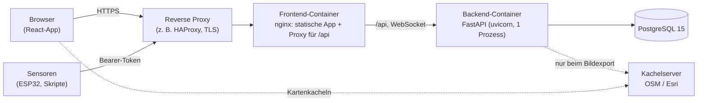

# Messdaten Karte

Webanwendung, mit der mehrere Personen gemeinsam **ortsbezogene Messwerte** (Temperatur, Luftfeuchte, Feinstaub, Wohlbefinden, …) in einem **kreisförmigen Zielgebiet** erfassen. Die Messpunkte erscheinen live auf einer Karte; daraus berechnet das Backend pro Messgröße eine **interpolierte Farbkarte (Heatmap)**, auf der Hotspots und Coldspots sofort zu sehen sind.

1. Ein angemeldeter Benutzer legt ein **Projekt** an (Name, Mittelpunkt und Radius, Messgrößen).
2. Er teilt den **Link oder QR-Code** der öffentlichen Karte.
3. Beliebige Personen öffnen die Karte (auch ohne Konto), tippen in den Kreis oder nutzen „Mein Standort“ und tragen Werte ein.
4. Alle offenen Karten aktualisieren sich live, die Heatmap wird neu berechnet.
5. Sensoren (z. B. ESP32) senden Messwerte automatisch per **API-Token**.

## Funktionen

- **Karte** (Leaflet) mit Straßenansicht (OpenStreetMap) und Satellit (Esri), Heatmap-Overlay und nach Messgröße eingefärbten Punkten
- **Heatmap per Kriging** (`pykrige`) mit dynamischer Farbskala aus dem kleinsten und größten Messwert im gewählten Zeitbereich
- **Zeitbereich** frei wählbar (Schnellwahl oder eigene Grenzen), Teil der URL und damit teilbar; **Replay** mit gleitendem Fenster oder kumulativ
- **Live-Updates** per WebSocket, mit automatischem Wiederverbinden
- **Rollen**: anonym, angemeldet, Projektmitglied (`owner`/`editor`), Admin; anonyme Messungen sind kurz über einen Edit-Token änderbar
- **Validierung** auf dem Server: Punkt im Kreis, Werte innerhalb der Grenzen der Messgröße, Limits pro Projekt
- **Export**: CSV, GeoJSON sowie Kartenbild als SVG (Vektor) oder PNG/JPEG mit Hintergrundkarte und einstellbarer Auflösung
- **API-Tokens** (`measurements:write` für Sensoren, `full` für Skripte), optional auf ein Projekt beschränkt
- **Zweisprachig** (Deutsch und Englisch), Hell- und Dunkelmodus, bedienbar auf dem Handy
- **Archivieren** von Projekten, Moderation (Messungen ausblenden oder löschen)

## Architektur



**Frontend** (`frontend/`): Single-Page-App mit React 18, Vite und TypeScript. Zustand und Server-Daten über TanStack Query, Karte mit Leaflet, Texte über `react-i18next`. nginx liefert die gebauten Dateien aus und leitet `/api` (inklusive WebSocket) an das Backend weiter.

**Backend** (`backend/`): FastAPI mit asynchronem SQLAlchemy (psycopg 3) auf PostgreSQL, Migrationen mit Alembic. Alle Endpunkte liegen unter `/api` ([`openapi.yaml`](openapi.yaml), interaktiv unter `/docs`).

| Bereich | Umsetzung |
|---|---|
| Anmeldung | Session-Cookie (signiert, `HttpOnly`, `Secure`, `SameSite=Lax`), „Angemeldet bleiben“ verlängert die Laufzeit; Passwortänderung, Admin-Reset und Sperren machen alte Sessions sofort ungültig |
| CSRF | Header `X-CSRF-Token` für schreibende Requests mit Session-Cookie; Bearer-Tokens und anonyme Requests brauchen ihn nicht |
| Berechtigungen | Zentral in `app/deps.py`: nicht sichtbare Projekte liefern 404, Mitglieder und Admins dürfen immer messen, alle anderen nur bei „öffentlich + bearbeitbar“ |
| Live-Updates | WebSocket-Kanal pro Projekt (`app/services/hub.py`); Mitglieder erhalten zusätzlich Moderationsereignisse |
| Heatmap | Ordinary Kriging, dessen Punkte sich über das ganze Gebiet beeinflussen; IDW-Fallback bei Fehlern; Cache mit Entprellung (`app/services/heatmap.py`) |
| Bildexport | Matplotlib; die Hintergrundkarte setzt der Server aus Kacheln zusammen (`app/services/tiles.py`) |
| Fehler | Maschinenlesbare Codes (`{"code": "...", "message": "..."}`), das Frontend übersetzt sie |

Das Backend läuft bewusst mit **einem Prozess**: Rate-Limits, WebSocket-Hub und Heatmap-Cache liegen im Arbeitsspeicher. Für den vorgesehenen Maßstab (Homelab; Tausende gleichzeitige Nutzer sind kein Ziel) reicht das; für mehrere Prozesse müssten diese drei Teile in einen gemeinsamen Speicher ziehen.

### Projektstruktur

```
.
├── backend/                FastAPI-Anwendung
│   ├── app/
│   │   ├── routers/        Endpunkte (Auth, Projekte, Messungen, Heatmap, Export, Tokens, Admin, Live)
│   │   ├── services/       Heatmap, Hub, Rate-Limit, Kacheln, Bildrenderer, Geometrie
│   │   ├── models.py       Datenbankmodelle (SQLAlchemy)
│   │   ├── schemas.py      Ein-/Ausgabe-Schemas (Pydantic)
│   │   └── deps.py         Anmeldung und Berechtigungen
│   ├── migrations/         Alembic
│   └── tests/              pytest (laufen gegen eine eigene Test-Datenbank)
├── frontend/               React-App
│   └── src/
│       ├── pages/          Seiten (Karte, Projekte, Einstellungen, Tokens, Admin, …)
│       ├── map/            Karte, Heatmap-Overlay, Zeitleiste/Replay, Eintragen-Formular, Live
│       ├── components/     gemeinsame Bausteine
│       ├── api/            API-Client und Typen
│       └── i18n/           Übersetzungen (de.json, en.json)
├── compose.yaml            Datenbank, Backend, Frontend
├── openapi.yaml            API-Beschreibung
├── projekt.md              Fachliche Beschreibung und Festlegungen
└── .github/workflows/      CI und Release
```

## Einrichtung mit Docker Compose

Voraussetzung: Docker mit Compose.

```bash
cp .env.example .env
```

In `.env` mindestens setzen:

| Variable | Bedeutung |
|---|---|
| `POSTGRES_PASSWORD` | Datenbankpasswort, nur Buchstaben und Ziffern, z. B. `openssl rand -hex 24` |
| `SECRET_KEY` | Schlüssel für die Sessions, mindestens 32 Zeichen, z. B. `openssl rand -base64 48` |
| `ADMIN_USERNAME`, `ADMIN_PASSWORD` | Legt beim Start den ersten Admin an (nur, falls es den Benutzer noch nicht gibt) |

Starten und öffnen:

```bash
docker compose --profile frontend up -d --build
```

Die App ist dann unter <http://127.0.0.1:8080> erreichbar. Ohne `--profile frontend` starten nur Datenbank und Backend (API auf `127.0.0.1:8000`). Die Datenbank-Migrationen laufen beim Start des Backends automatisch.

Weitere Admins legt man in der Oberfläche an oder per Kommandozeile:

```bash
docker compose exec -it backend python -m app.cli create-admin <benutzername>
```

### Betrieb hinter einem Reverse Proxy

- **HTTPS ist nötig**: Der Browser erlaubt Standortabfragen nur über HTTPS, und die Session-Cookies sind `Secure`. Nur für lokale Tests über reines HTTP `COOKIE_SECURE=false` setzen.
- Der Proxy muss **WebSockets** durchreichen und leitet auf den Frontend-Port (`HTTP_BIND`/`HTTP_PORT`, Standard `127.0.0.1:8080`). Das Frontend-nginx übernimmt die Client-IP aus `X-Forwarded-For` von privaten Adressen.
- Daten liegen im Volume `pgdata`. Sicherungen z. B. mit `pg_dump`.
- Die Kartenkacheln lädt der **Browser** direkt von OpenStreetMap bzw. Esri; dabei sehen diese Dienste die IP der Besucher. Die Anwendung selbst speichert keine IP-Adressen (außer kurzzeitig für Rate-Limits im Arbeitsspeicher). Schriften werden selbst ausgeliefert.

### Fertige Images

Jedes Release veröffentlicht die Images (`linux/amd64` und `linux/arm64`) in der GitHub Container Registry:

```
ghcr.io/mint-labs-regensburg/messdaten-karte-backend:<version>
ghcr.io/mint-labs-regensburg/messdaten-karte-frontend:<version>
```

Für `<version>` gibt es `1.2.3`, `1.2` und `1` sowie `latest`. `latest` ist immer das neueste Release und wird mit jedem Release neu gesetzt. Vorabversionen (`1.2.0-rc.1`) bekommen nur ihren eigenen Tag. Für den Produktivbetrieb empfiehlt sich eine feste Version statt `latest`.

In `compose.yaml` statt `build:` das passende `image:` eintragen und mit `docker compose pull && docker compose up -d` starten.

### Wichtige Einstellungen

Alle Einstellungen kommen aus Umgebungsvariablen (siehe [`.env.example`](.env.example) und `backend/app/config.py`). Eine Auswahl:

| Variable | Standard | Bedeutung |
|---|---|---|
| `MAX_RADIUS_M` | `5000` | größter erlaubter Projektradius in Metern |
| `MAX_MEASUREMENTS_PER_PROJECT` | `5000` | Limit pro Projekt |
| `EDIT_WINDOW_SECONDS` | `900` | so lange können anonyme Autoren ihre Messung ändern |
| `REGISTRATION_DEFAULT` | `true` | ob Registrierung erlaubt ist, solange kein Admin sie umstellt |
| `COOKIE_SECURE` | `true` | `Secure`-Flag der Cookies |
| `TILE_USER_AGENT` | `MessdatenKarte/0.1 (self-hosted)` | User-Agent beim Laden von Kacheln für den Bildexport; bei öffentlichem Betrieb mit Kontaktdaten ergänzen (Nutzungsbedingungen von OpenStreetMap) |
| `ALLOWED_ORIGINS` | `[]` | zusätzlich erlaubte Origins für WebSockets (JSON-Liste) |

## Entwicklung

Arbeitsregeln für Code und Tests stehen in [`CLAUDE.md`](CLAUDE.md): Python wird ausschließlich mit **ruff** formatiert und geprüft, neue Funktionen und Fehlerkorrekturen bekommen Tests im selben Commit, Oberflächentexte stehen nur in den Übersetzungsdateien. Änderungen entstehen auf **Feature-Branches** und kommen per **Pull Request** auf `main`.

### Backend

Voraussetzung: [uv](https://docs.astral.sh/uv/) und Python 3.14 (uv lädt es bei Bedarf).

```bash
cd backend
cp .env.example .env            # DATABASE_URL und SECRET_KEY eintragen
uv sync
uv run alembic upgrade head
uv run python -m app.cli create-admin <benutzername>
uv run uvicorn app.main:create_app --factory --reload
```

Die interaktive API-Dokumentation ist unter <http://localhost:8000/docs> erreichbar.

Tests brauchen eine Wegwerf-Datenbank (der Datenbankname muss auf `_test` enden):

```bash
docker compose -f compose.test.yaml up -d --wait   # Postgres auf 127.0.0.1:55432
uv run ruff format . && uv run ruff check .
uv run pytest
```

### Frontend

Voraussetzung: Node 22.

```bash
cd frontend
npm ci
npm run dev          # http://localhost:5173, /api geht an das Backend auf Port 8000
npm run typecheck
npm test
npm run build
```

Mehr dazu in [`backend/README.md`](backend/README.md) und [`frontend/README.md`](frontend/README.md).

## Continuous Integration und Releases

- **CI** (`.github/workflows/ci.yml`) läuft bei jedem Push auf einen Branch und bei jedem Pull Request: Backend (ruff, pytest gegen Postgres), Frontend (Typecheck, Tests, Build) und ein Probebau beider Docker-Images.
- **Release** (`.github/workflows/release.yml`) startet bei einem Versions-Tag (`v1.2.0`, Vorabversion `v1.2.0-rc.1`): zuerst alle Tests, dann werden die Docker-Images gebaut und veröffentlicht, danach entsteht das GitHub Release mit automatisch erzeugten Notizen.

```bash
git tag v1.2.0 && git push origin v1.2.0
```

## Dokumentation

- [`projekt.md`](projekt.md): fachliche Beschreibung, Rollen, Datenmodell und alle Festlegungen
- [`openapi.yaml`](openapi.yaml): REST- und WebSocket-Schnittstelle

## Lizenz

Lizenziert unter der [Apache License, Version 2.0](LICENSE).
